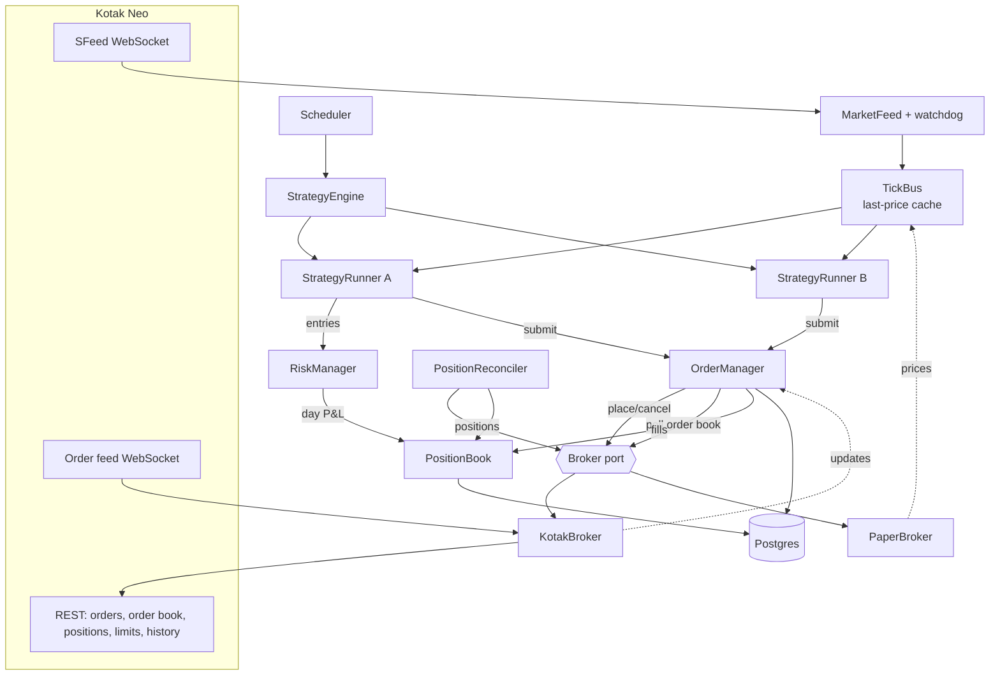

# System Design

Single asyncio process (FastAPI + background tasks). Blocking Kotak SDK REST calls run on a
thread pool; the market and order WebSockets are native async.



## Order lifecycle

```
PENDING ──ack──> OPEN ──fills──> FILLED
   │               └──> CANCELLED (may be partially filled)
   ├──reject──> REJECTED
   └──transport error──> UNKNOWN ──found by tag──> OPEN/FILLED/...
                                 └──absent 30s──> FAILED
```

1. Write-ahead: row inserted (`PENDING`) before the broker call; our id is the broker `tag`.
2. Updates arrive from the order feed and from polling the order book. Both carry cumulative
   filled quantity, so applying either (or both) is idempotent.
3. A fill writes the fill row, the order's fill state and the instance position in one
   transaction.
4. Unfilled limit orders are cancelled after `LIMIT_ORDER_TTL_SECONDS`.

## Recovery

| Failure | Behaviour |
|---|---|
| Process crash / restart | Orders, positions, P&L, strategy state, stops and kill switch reload from DB; open orders matched to the broker book by tag; positions reconciled; indicators warmed from history; ACTIVE instances resume. |
| Crash between saving and sending an order | Row is PENDING → treated as UNKNOWN; matched by tag or failed after 30s. Never resent automatically. |
| Broker down at startup | API still starts; login retried with backoff; recovery runs once connected. |
| Session expiry / new day | Auth-looking errors trigger re-login + one retry; daily refresh job at 08:30. |
| Market feed silent | Watchdog rebuilds the socket after 30s of silence during market hours. |
| Order feed down | Polling continues (2s while orders are open). |
| Strategy exception | Logged; 5 in a row → instance disabled and flattened, alert sent. |
| Repeated rejections | Exponential cooldown per instance (2s … 5 min), alert at 3. |
| Position mismatch (auto square-off, manual trade) | Broker figure adopted after two consecutive checks (immediately at startup); untracked positions reported. |
| Daily loss breached | Kill switch: flatten all, block entries, persisted for the day. |

## Concurrency rules

- Each `StrategyRunner` serialises its own events with a lock, so a strategy never runs
  concurrently with itself.
- OMS listener callbacks go through one dispatcher task, so a fill reported during `submit`
  (paper mode) cannot deadlock the runner.
- Risk's kill-switch flatten and the runner's auto-disable run in separate tasks, so a
  strategy task never waits on itself.
